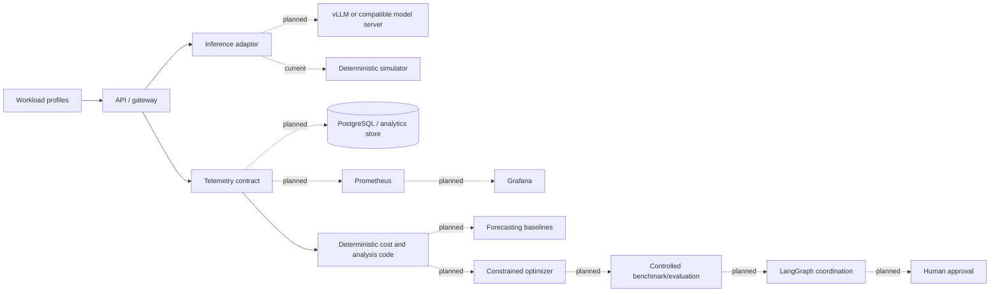

# YieldOps Architecture: Current and Intended

## Current implementation

The implemented system is a small HTTP API with a deterministic simulator. It validates an inference-shaped request, synthesizes a response and timing fields, stores prompt-free telemetry in process memory, and returns a summary. No model server, database, metrics server, agent, or optimizer is connected.

```mermaid
flowchart LR
    WG["Synthetic workload runner<br/>scripts/run_synthetic_workload.py"] -->|HTTP POST /v1/inference| API["FastAPI<br/>src/yieldops/api/main.py"]
    API -->|Pydantic validation| SCHEMA["Schemas<br/>src/yieldops/common/schemas.py"]
    API -->|infer(request)| SIM["SimulatedInferenceBackend<br/>src/yieldops/inference/simulator.py"]
    SIM -->|response + synthetic telemetry| API
    API -->|metadata only| STORE["InMemoryTelemetryStore\nsrc/yieldops/telemetry/store.py"]
    WG -->|HTTP GET /v1/telemetry/summary| API
    API -->|nearest-rank P50/P95/P99| STORE
    STORE -->|summary JSON| API
```

`GET /health` returns a static success response. `POST /v1/inference` validates with `InferenceRequest`, invokes `SimulatedInferenceBackend.infer`, appends its `InferenceTelemetry`, and returns an `InferenceResponse`. `GET /v1/telemetry/summary` summarizes the most recent retained records. The app stores a module-level backend and store; both are in-process objects.

The test suite calls the app in-process with FastAPI `TestClient`. The separate 20-request smoke run used an HTTP server and the script in `scripts/run_synthetic_workload.py`; it was a local simulator check, not a model benchmark.

## Planned architecture (not implemented)



Dashed paths are proposals from the project vision, not working integrations. The app currently has no persistent boundary, background job queue, service-to-service tracing, or infrastructure control plane.

## Data flow and communication

1. The workload runner selects one of four fixed synthetic task prompts and sends an HTTP JSON request.
2. FastAPI/Pydantic validates required fields, lengths, category, and limits.
3. The simulator counts whitespace-separated prompt pieces, returns the fixed text `simulated completion` (subject to the output-token cap), and calculates synthetic latencies from constants.
4. The API stores the telemetry object without prompt or completion text.
5. The client requests a summary. The store totals token counts and computes nearest-rank percentiles over retained simulated latencies.

The store is bounded to 10,000 records and loses all records at process exit. It is not shared between worker processes.

## Source map

- API and routes: `src/yieldops/api/main.py`
- Request/response/telemetry contracts: `src/yieldops/common/schemas.py`
- Simulator: `src/yieldops/inference/simulator.py`
- In-memory aggregation: `src/yieldops/telemetry/store.py`
- Workload generation/statistics: `src/yieldops/workload/generator.py`
- Workload CLI: `scripts/run_synthetic_workload.py`
- Tests: `tests/unit/` and `tests/integration/`

## Security/data boundary

The app has no authentication or authorization. Prompts pass through the API process but are not copied into telemetry. There is no database access, external inference API, or infrastructure-changing tool in the current app. The README's approval requirement is a design requirement, not an implemented approval workflow.
