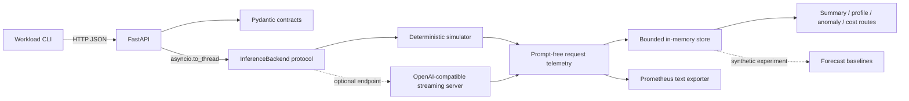

# YieldOps Architecture

## Implemented components

The OpenAI-compatible adapter is implemented and tested against a mock HTTP server. It has **not** been run against model weights. The simulator remains the default. Prometheus output is a small standard-library text exporter; no Prometheus server or Grafana dashboard is deployed.

### Request path

1. `InferenceRequest` validates prompt length, model label, task category, token limit, temperature, and top-p.
2. FastAPI runs the synchronous backend through `asyncio.to_thread`, so a blocking model-server call does not block the event loop.
3. The simulator emits deterministic output and simulated timings/counts. The optional streaming backend posts to an OpenAI-compatible `/chat/completions` endpoint, measures first content and end-to-end wall time, and reads tokenizer usage only when the server returns it.
4. The API retains metadata only. Prompt and completion content are not part of telemetry or exception records.
5. In-memory summary, profile, anomaly, and cost functions operate on the most recent bounded telemetry sample. `/metrics` exposes per-process request counters and latency histogram buckets.

## Telemetry contract

`InferenceTelemetry.provenance` labels timing values as `simulated`, `measured`, or `estimated`. `token_count_provenance` independently describes token counts because a real server may measure its timing but omit tokenizer usage. In that case token counts are `null`, not whitespace estimates. Summary totals sum known token counts and report how many records lacked counts.

`TelemetrySummary.provenance` is one value when all retained records share provenance and `null` when the sample is mixed or empty. Explicit counts for simulated, measured, and estimated records remain available.

## Cost and intelligence

- `profile_telemetry` groups retained metadata by model and workload category and reports request volume, success/failure counts, token totals, latency percentiles, throughput when the retained time span is non-zero, and peak/per-minute request buckets.
- `estimate_token_cost` applies the submitted per-model USD/1,000-token rates. Its output is always labeled estimated. No provider bill or GPU-hour cost is represented.
- `detect_high_latency` uses a rolling prior-window median and median absolute deviation (MAD); it is a baseline, not an ML detector.
- Forecasting functions compare a last-value forecast with a 24-hour seasonal-naive forecast on a separate generated, time-ordered synthetic dataset.

## Storage and boundaries

The application keeps the existing 10,000-record process-local store. It resets on restart and is not shared across workers. PostgreSQL is not added: this stage has no persistent telemetry requirement or multi-process benchmark, and the local learning path benefits from no database service. Revisit when persistence, multi-worker aggregation, or long-running experiments become necessary.

There are still no agents, orchestrator, GPU telemetry source, cloud billing integration, Docker deployment, authentication, or production monitoring stack. Agent work remains reserved for the later plan milestone.

## Source map

- API and routes: `src/yieldops/api/main.py`
- Contracts: `src/yieldops/common/schemas.py`
- Backend protocol: `src/yieldops/inference/backend.py`
- Simulator: `src/yieldops/inference/simulator.py`
- Optional streaming adapter: `src/yieldops/inference/openai_compatible.py`
- Telemetry store and exporter: `src/yieldops/telemetry/`
- Workload runner and profiling: `src/yieldops/workload/`
- Cost estimate: `src/yieldops/cost/attribution.py`
- Anomaly baseline: `src/yieldops/evaluation/anomaly.py`
- Forecast baselines: `src/yieldops/forecasting/baselines.py`
- Tests: `tests/unit/`, `tests/integration/`
- Reproducible experiments: `scripts/run_inprocess_benchmark.py`, `scripts/run_milestone_experiments.py`
